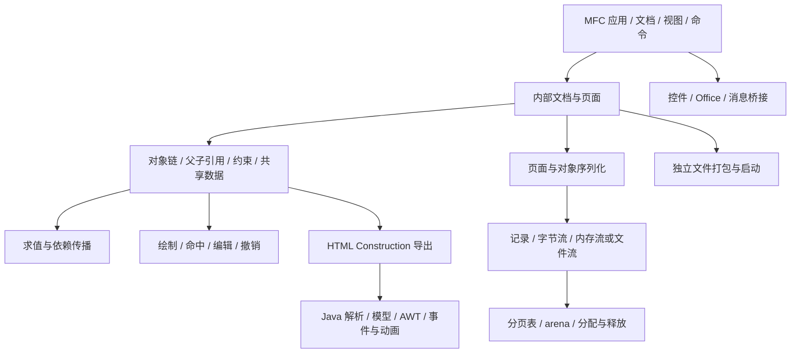

# 架构与实现边界

这里描述实现结构；任务顺序和验收条件统一见 [PLAN.md](PLAN.md)。字段细节以原件、完整反汇编和各模块来源记录为准。

## 原生主程序

主程序是 Win32/x86 原生实现。MFC 文档持有独立内部模型；几何对象不是简单逐个 MFC 对象序列化。已观察到文档 `+0x158` 模型指针、页面数组 `+0x0C`、数量 `+0x10`、页内对象链 `+0x110`、对象 next `+0x84`。这些位置是已观察字段，不代表完整类型定义。

页面切换 `00404060` 涉及 `DAT_006BA204/208/20C/210` 和 `DAT_006BBA54`，以及页内 `+0x18C` arena 缓存。必须在真实创建、切页、扩容、释放中闭合拥有权，不能长期依靠测试人工填写内存。

保存路径已知种子：`004A8520 → 00437790 → 004A80F0 → 004A7A60 → 类型转换 → record/stream`。读取路径 `004AA310` 的内部记录分派、对象构造和引用修复仍未实现。地址是调查入口；未证明的职责与函数边界不能直接变成已实现声明。

## 恢复原则

- 原生对象布局、状态、算法和调用关系以原生证据为准。Java 是独立组件及对照材料，不替代原生内核。
- `native/src/serialization_integration.cpp` 连接已经恢复的函数；其 unknown converter、hook 和 legacy 边界目前仍缺生产实现。
- 原寄存器/x87 ABI 与当前 cdecl 源接口的差异要登记。数值、异常、错误码、清理和副作用同样属于兼容范围。
- 框架/CRT/第三方代码与业务代码分开归属。能确定来源的库优先使用可核验、可构建的对应实现；替换库也须有行为证据，不能因版本名相似就关闭缺口。
- CLI、诊断视图和测试驱动可以作为薄适配层帮助集成；不能另外写一套模型来绕过恢复中的对象生命周期。
- 未知类型在中期产物中明确报不支持，不能丢弃、置零或伪造成功；最终验收必须关闭范围内的不支持项。

## 配套组件

`Control/GSP5.exe` 与中文主程序大量代码相同，但存在已观察的代码和资源差异，需形成有证据的共同核心与变体构建。`jhhb5.ocx`、`AddGSP.dll`、`gspmsg.dll` 分别涉及控件、Office 桥接及消息辅助；具体接口要从类型库、调用和宿主实验核实。

`GSP2EXE.exe` 和 `Sample.exe` 涉及发布打包、容器和启动。它们纳入长期目标，但不阻塞最小几何编辑闭环。系统 DLL、JVM、Office/WPS 宿主本身是外部环境。

## 详细技术来源

- [原生模型、状态和函数边界](../analysis/recovery-native-architecture.md)
- [原始分发表及引用](../analysis/recovery-object-dispatch.json)
- [文件格式证据](../analysis/gsp-format.md)
- [Java 组件架构](../analysis/recovery-java-architecture.md)
- `native/provenance-*.json`、`native/RECOVERY-*.md`：逐模块来源和验证边界
