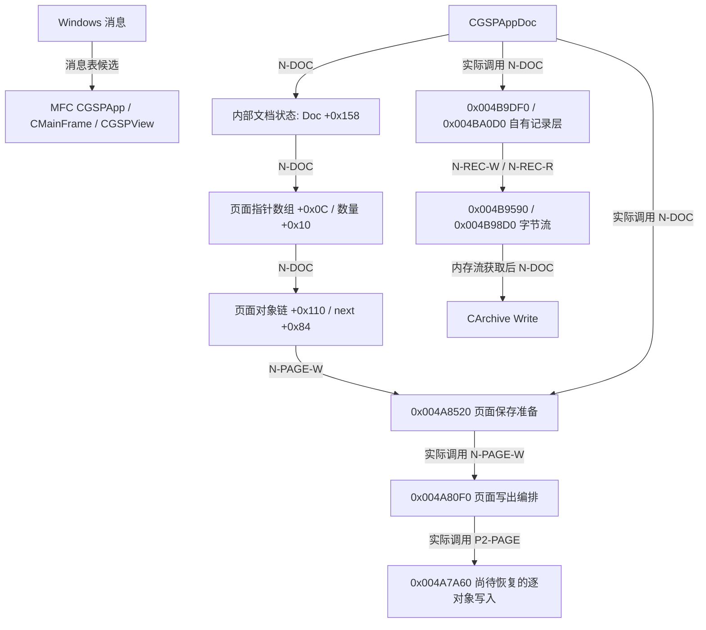

# 原生架构恢复基线

本文保留`pe-address-seeds.json`、`rea-native`与`recovery-pass2`等静态证据的调用关系和布局，不维护当前进度或任务队列。当前实现见[恢复说明](../recovered/README.md)，唯一实施顺序见[总计划](../recovered/PLAN.md)。证据中的语义候选不等于已实现功能。

目标：`analysis/unpacked/GSP5chs.exe`，x86 PE32，首选 ImageBase `0x00400000`，SHA-256 `de41b856eb11657a27e64ea14ecdab4e1aef6518e02e7cc39d2713b260964e7a`。除特别说明外，地址都是该目标的 VA。`FUN_...` 为分析器名称；临时语义名均为恢复标签。

## 证据索引

| 标签 | 来源与范围 | Evidence ID / 精确位置 |
|---|---|---|
| N-DOC | `doc-serialize-candidate.json/.c`，`0x004F59D0` | `ev_83083fb5b725d29aeb07c53393e622da1766726304e5d51a8b643e9dbf0cee54` |
| N-LOAD | `doc-load.json/.c`，`0x00416A10` | `ev_830a747bcb6afbbf86763f81642ba327c686ad5d1a8a111b69bc46fdac9fe48a` |
| N-HEAD-R | `gsp-reader.json/.c`，`0x00416230` | `ev_517dac7ac3f46eeda677b3102e96ed0b41befe8eb24c589857ae9365108f0ebd` |
| N-HEAD-W | `gsp-writer.json/.c`，`0x00416610` | `ev_4bb8dca218ff95e43239dcd65674994b367ed51e97076c7366fc40b47f7b671c` |
| N-PAGE-W | `page-write.json/.c`，`0x004A8520` | `ev_5aa8a9ebd6b2495fc802e30a9811708eaebaa744a214c6ea821c3aa76eb2793d` |
| N-REC-W | `record-dispatch.json/.c`，`0x004B9DF0` | `ev_e9d65e3714ee3b786a24e9af93e32dae25184f19e8a100d2cb2beaf29144a620` |
| N-REC-HEAD-W | `record-write.json/.c`，`0x004B9D50` | `ev_73ae5bc5a38a838bd6c0e9c977437c4b372b8a3ef255a2c013c63421b7ba7534` |
| N-REC-R | `record-read.json/.c`，`0x004BA0D0` | `ev_19c9e048a502fefe6f707c0059107fc8f94b749c50db69d811b8658c32dd0cc1` |
| N-BYTES-W | `record-header-write.json/.c`，`0x004B9590` | `ev_4987a7a8a6a483cb65e9077b25e2ea8e0492bcc64b6444b9d39a142c21d14ea8` |
| N-BYTES-R | `record-header-read.json/.c`，`0x004B98D0` | `ev_b2beb6b8ab2736d790b078726bbcda1cac6bf328dad1dec5f3cdc092db0a1391` |
| N-EXPORT | `html-export.json/.c`，`0x004AD660` | `ev_b1f1ba2620a5bc4829f1dea007574c0a752ed11231c91e3ce096802b9c9154a3` |
| N-FACT-DOC | `doc-factory.json/.c`，`0x004F5670` | `ev_58f214decd371d373d1823f24fc5d86a1d0653715f0210f341705088eeaea38d` |
| N-FACT-VIEW | `view-factory.json/.c`，`0x0050C580` | `ev_2f9b24acbfcf7fcd8d2523e7ee69c1a39822d2c5455dbb51f90442f9f731ab24` |
| P2-CONTEXT | `recovery-pass2/context-guard.json/.c`，`0x00404060` | `ev_f3ac2786567fd57b49ffe59d7c513d13506b6ff2da48a88c2a6df1414d3e628c` |
| P2-TABLE | `recovery-pass2/handle-lookup.json/.c`，`0x00434150` | `ev_428cd7dc9af260b27bde720f4d5517b9093386b01286624a0c40693a714b6630` |
| P2-TABLE-CREATE | `recovery-pass2/blocktable-create.json/.c`，`0x00433F90` | `ev_443b4f7e9c337fdc91098517e1f729558b0dd29eeb98416354d611f1cc5c6761` |
| P2-TABLE-ALLOC | `recovery-pass2/blocktable-allocate.json/.c`，`0x00434090` | `ev_17223cf28ce5d89804d9350930adc1c3bafb6efa4c0a79370a3193ce5a17baea` |
| P2-TABLE-GROW | `recovery-pass2/blocktable-grow.json/.c`，`0x004340E0` | `ev_33e1f716880716b641ad5fe1908944b10f28500cb05564312c025a70979e0995` |
| P2-TABLE-PTR | `recovery-pass2/handle-current.json/.c`，`0x004341D0` | `ev_f27fdd1c8683a160c13e46c255fa7277b105f1bf04ccc5b209e264fb8f52b37a` |
| P2-PAGE | `recovery-pass2/page-serializer.json/.c`，`0x004A80F0` | `ev_61dcb19a6d1950474d6bb28c9a2a8533f0cfddc049ad2cee31863b2dcdf3ab38` |
| P2-MEM-W | `recovery-pass2/stream-memory-write.json/.c`，`0x004B9410` | `ev_a38317170bbc80e69afd10c2949b4d58da39b817973c7da038799d03859153f8` |
| P2-MEM-R | `recovery-pass2/stream-memory-read.json/.c`，`0x004B9760` | `ev_bf63b206793f02563dad05ebd94e709dabc3aeb710ee0e1aa29abf9c6a8c8c0a` |
| P2-BOUNDED-R | `recovery-pass2/stream-third-read.json/.c`，`0x004B9860` | `ev_ba03813c581a7ec68f03061dfc98d86ce365a42e9d27390c408b3951f81d9d4c` |
| P2-MEM-CREATE | `recovery-pass2/primitive-stream-init.json/.c`，`0x004B8E50` | `ev_ca34a71c9aa077487f40c5a30bcfaca059b57af9e1a8ce4c8dac89bfb773dd16` |
| P2-CONSTRAINT-OWNER | `recovery-pass2/constraint-owner.json`，查询`0x0043B346` | `ev_bdae967603a4d9b3e2827a2d9086cda3ec8817bddc846e8516daa3311d433ca5` |
| S-TABLES | `pe-address-seeds.json`，结构模式解析 | CRuntimeClass / vtable / 消息表确切 VA 见下表；尚非全部反汇编器验证的类型关系 |

## 已确认的分层与尚未确认的关系

现有证据支持把恢复工程分成 Windows/MFC 文档与视图外壳、内部文档/页面/对象状态、自有记录流、对象保存/加载分发、导出等层。这里只能确认其中的部分连接。

`M → D` 的完整创建/路由链、绘制、命中测试和拖动更新链在本文静态材料中尚未闭合。对象serializer及局部几何已有独立模块证据，见当前恢复说明。图中不得补成已证实的调用边。

### 1. Windows/MFC 外壳

| 原生名称 | CRuntimeClass VA | vtable VA | 结构中声明的对象大小 | 当前状态 |
|---|---|---|---:|---|
| `CGSPApp` | `0x0065A930` | `0x0065AC6C` | `0x150` | 结构候选；消息表 getter `0x004F2A60` |
| `CGSPAppDoc` | `0x0065ADA0` | `0x0065AFE4` | `0x160` | 工厂分配 `0x160` 由 N-FACT-DOC 独立支持；调用构造候选 `0x004F5710` |
| `CGSPView` | `0x0065CF0C` | `0x0065D30C` | `0x1C8` | 工厂分配 `0x1C8` 由 N-FACT-VIEW 独立支持；调用构造候选 `0x0050C620` |
| `CMainFrame` | `0x0065DF74` | `0x0065E564` | `0x8D0` | 结构候选；消息表 getter `0x00516A80` |
| `CGSPDocTemplate` | `0x0065BBB8` | `0x0065BBDC` | `0x90` | 结构候选 |
| `CGspDocManager` | `0x0065BB00` | `0x0065BB6C` | `0x20` | 结构候选 |
| `CGspFileDialog` | `0x0065BC78` | `0x0065BCEC` | `0x318` | 结构候选 |

`CGSPAppDoc` vtable 槽 2 指向 `0x004F59D0`，该函数实际接收 `CArchive*` 并调用 `CArchive::Read/Write`，因此将它标为 Serialize 恢复标签有独立函数证据。[S-TABLES, N-DOC]

这不意味着内部对象都采用 MFC 的 `CObject/Serialize` 层次。N-DOC 从 `this+0x158` 取独立指针，再以普通偏移访问页面数组、当前页和状态。当前最强解释是 MFC 文档拥有一个内部模型句柄/指针；其创建、释放、所有权、是否共享仍待构造/析构闭环。[N-DOC]

PE Linker 8.0、MFC/ATL RTTI、大量框架实现和无普通 MFC DLL 导入一起支持“MSVC C++、静态 MFC”候选，但不能据此确定原始 `.vcproj`、精确编译器补丁、静态 CRT 选项或所有库版本。框架和CRT识别应按函数签名与引用证据逐项确认，不能按地址大小划一条“应用/库”分界。[`pe-findings.md`]

### 2. 内部数据模型：先保留偏移，再命名

表中“确认”指所列函数确实如此访问该偏移，不表示完整结构、原始字段名或字段生命周期已恢复。

| 基址 / 偏移 | 静态观察 | 语义判定 | 证据 |
|---|---|---|---|
| MFC Doc `+0x158` | 保存路径从此取内部状态指针 | 内部文档状态指针候选，置信度高 | N-DOC |
| 内部文档 `+0x0C` | 元素按 `index*4` 取得，并作为页面保存参数 | 页面指针数组，确认访问 | N-DOC |
| 内部文档 `+0x10` | 保存循环上界；写入头 payload+2 | 页面数量，确认对应 | N-DOC，N-HEAD-W |
| 内部文档 `+0x14` | 读头时由页面计数初始化，与 `+0x0C` 分配相邻 | 页面容量/计划数量候选 | N-HEAD-R |
| 内部文档 `+0x18` | 可空；首 dword 为计数，后续记录按4个dword步长访问并取页面保存 | 第二种页面/构造集合候选，具体业务名未知 | N-DOC，N-HEAD-R |
| 内部文档 `+0x24/+0x28` | 8字节步长表与计数；对应保存1004/1005包围记录 | 另一类文档成员集合，类型未知 | N-DOC |
| 内部文档 `+0x30/+0x34` | 读头分配与加载完成计数更新 | 另一类成员集合候选，类型未知 | N-HEAD-R，N-LOAD |
| 内部文档 `+0x48` | 保存时搜索它在页数组的索引；加载时按头索引恢复 | 当前/活动页面指针候选，置信度高 | N-DOC，N-LOAD |
| 内部文档 `+0x50` | 保存成功清零，加载警告设1，并向全局通知相关位 | 修改/恢复状态标志候选，确切语义未知 | N-DOC，N-LOAD |
| 内部文档 `+0x58/+0x5C/+0x5E` | 16位字段写入文件头，读回后部分值夹到至少50 | 文档设置字段，禁止提前命名为缩放/尺寸 | N-DOC，N-HEAD-R/W |
| 页面 `+0x110` | 首对象指针，循环取对象`+0x84` | 对象链头，确认访问 | N-PAGE-W，N-EXPORT |
| 页面 `+0x290` | 保存准备后写入对象总数 | 保存相关对象数，确认访问 | N-PAGE-W |
| 页面 `+0x294/+0x29C` | 指定模式保存成功后复制前者到后者 | 两个快照/状态字段候选 | N-PAGE-W |
| 页面/上下文 `+0x568/+0x56C` | 全局上下文切换/保存从此取关联指针 | 后端关联指针未知；是否所有页面均具备待查 | N-PAGE-W，N-DOC |
| 对象 `+0x0C` | 保存文档前扫描，值等于`0x10`时调用`0x00490E60` | 对象种类/标志候选，不足以命名为具体几何类 | N-DOC |
| 对象 `+0x84` | 用作下一个对象地址 | 链表next，确认访问 | N-PAGE-W，N-EXPORT |
| 对象 `+0xC4` | GSP保存清零后写1..N；导出时清零后写1或2起递增值 | 临时标记/遍历编号槽；只在GSP保存阶段可称页内1-based编号 | N-PAGE-W，N-EXPORT |

`+0xC4` 在导出和原生保存中复用，说明不能把它固定命名为永存对象ID。也不能把尚未确认的对象基址强制声明成有vptr的C++类。现有证据允许它是显式分发的结构体系；完整 RTTI 搜索里没有恢复出几何对象层次并不能证明该层次不存在。

### 3. 全局上下文

| 全局 VA | 观察 | 当前标签与限制 |
|---|---|---|
| `0x006BA204` | N-PAGE-W 写首dword对象数、取`+0x56C`；P2-CONTEXT显式切换，并可通过EDX输出旧值 | 当前页面/模型上下文；页面语义由多个调用者支持 |
| `0x006BA208` | 恢复上下文时与旧页指针比较 | 与活动/显示页关系未知 |
| `0x006BA20C` | 上述比较后写0或1 | 上下文关系状态候选 |
| `0x006BA210` | 上下文非空时从`page+0x568`更新 | 当前页面关联指针缓存候选 |
| `0x006BA214` | N-DOC / N-LOAD 与内部文档状态比较后通知 | 当前文档上下文候选 |
| `0x006BBA54` | 换页时从旧页`+0x18C`读回，原值存入退出页同偏移 | 随页切换缓存字段，具体类型未知 |
| `0x006BB560` | 字节/记录层用其查流状态 | 活动流短句柄候选；底层`0x00434150/0x004341D0`实际是通用分页表索引，并非流专用函数 |
| `0x006B6A50/54/58` | 加载与文档保存开始时同时清零 | 序列化过程状态，语义未知 |
| `0x006BB9B8` | 文档状态变化设置bit `0x10`，条件调用通知函数 | 通知/延迟刷新位候选，不能命名为绘图dirty flag |

恢复工程需要明确保留这套全局状态依赖。改成新的可重入“Document类方法”会掩盖原实现的状态约定，不能算恢复原架构。

P2-CONTEXT已把`0x00404060`从入口/出口未知helper升级为明确的**当前页上下文切换函数**。EAX携带新页、EDX为可空的旧页输出地址；换页时更新`DAT_006BA210`，把全局`DAT_006BBA54`存回旧页`+0x18C`，再由新页加载该字段。相同非空页重复设置时不重复同步；相同空页设置时清`DAT_006BA20C`。它没有外部调用，是最适合先忠实转写并验证的原函数之一。`context-guard`只是导出时的探索性文件名，不能继续称作guard/锁。

### 3a. 通用分页存储表

P2-TABLE使早期“stream handle lookup”猜测得到修正：`0x00434150`是通用索引到元素的ensure操作。调用者可用它存流状态；底层算法本身不依赖FILE或几何类型。创建/增长/按块分配由`0x00433F90/0x004340E0/0x00434090`支持，`0x004341D0`是取得块地址与块内偏移之和的wrapper。[P2-TABLE、P2-TABLE-CREATE/ALLOC/GROW/PTR]

| 表偏移 | 观察到的作用 |
|---|---|
| `+0x00` | 元素字节宽度；创建时奇数向上补成偶数 |
| `+0x04` | 块内索引mask，即每块元素数-1 |
| `+0x08` | 块索引右移位数；创建时按至少8向上取2的幂 |
| `+0x0C` | 块指针数组容量；增长至少至所需块索引+1，否则约增25% |
| `+0x10` | 块指针数组，新增项清零；元素块延迟分配 |
| `+0x14`低16位 | 传给分配器的tag/类别字段；原业务名未知 |
| `+0x18` | 最大成功访问索引，创建为-1 |

`0x00434150`拒绝负索引；块号=`index >> shift`，块内字节偏移=`(index & mask)*element_size`。必要时扩容并分配零填充块，成功后推进high-water。这里已有足够原实现证据建立32位结构与首批函数恢复单元。分配/重分配包装`0x0043CB30/0x0043CBE0`的寄存器参数必须从Listing还原，不能因伪代码漏长参数就猜默认malloc调用。

### 4. 保存与加载不是MFC默认对象归档

已证保存链：`CGSPAppDoc` 的 `0x004F59D0` → 自有字节流及记录写入 → `0x004A8520` 页面保存准备 → `0x004A80F0` 页面写出编排 → `0x004A7A60`逐对象写入（外层现已恢复，见[模块说明](../recovered/native/RECOVERY-object-serialization.md)）；完成后 `0x004BAE70` 取缓冲区，`CArchive::Write` 输出。900/901等kind在内部自有记录层写入。[N-DOC，N-PAGE-W，P2-PAGE]

已证记录链：`0x004B9DF0` → `0x004B9D50` 写两个u32头 → `0x004B9590` 写payload及必要的零补齐。读侧 `0x004BA0D0` → `0x004B98D0`，容量不足或过剩有各自分支。完整Magic、28字节文档头、偶数补齐的汇编核对见 `native-serialization.md`。[N-REC-W，N-REC-HEAD-W，N-REC-R，N-BYTES-W/R]

字节流有显式种类分支。kind1为FILE；P2-MEM-W/R进一步确认kind2使用初始缓冲区与链式扩展块；P2-BOUNDED-R和P2-MEM-W确认kind3按基址+位置读写并做长度上界检查；kind4写入分支只返回成功，结合位置统计可作为计数/空后端候选，但原用途未闭环。流状态`+0x18`记录位置、`+0x24`保存错误状态。链块头含长度与next两个dword，随后是payload；`0x004B8E50`创建kind2流，默认初始容量`0x800`。[N-BYTES-W/R，P2-MEM-W/R、P2-BOUNDED-R、P2-MEM-CREATE]

已证加载骨架：`0x00416A10` → `0x00416230`读头并分配内部表 → `0x00436B50`读取下一成员的元信息候选 → 按`local_64`切到 `0x00416830`、`0x004AA560`、`0x00416140`、`0x004168F0`等。各分支完整对象构造和错误回滚尚未恢复，不能仅靠函数参数猜原始成员类型。[N-LOAD]

### 5. 对象调度、几何、渲染和交互的真实边界

**对象保存调度**：N-PAGE-W建立含对象指针的工作表，调用`0x00437790`后调用`0x004A80F0`。P2-PAGE显示后者以20字节stride遍历工作表，每项通过`param_1[5]`取对象指针、以`param_1[8]`低16位作为`0x004A7A60`的一个参数。逐对象结果`0x0D`会清对象`+0xC4`并减少上下文对象数；其余结果按实际保留顺序重新编号。它还调用页面元信息序列化helper，并产生1000/1001或1002/1003包围记录。2000/2002/2201的外层分发证据与实现见[对象保存模块](../recovered/native/RECOVERY-object-serialization.md)。

工作表的初始指针似乎带前缀，不能把`param_1[5]`误读成“20字节结构之外”。需联合`0x00437790`恢复分配总长、前缀及真正元素首地址。这是从文件框架进入真实几何对象代码的最短已知路径；目前没有证据支持自行设计新的Point/Line/Circle类替代。

**几何约束种子**：字符串 `Constrained GObj ... parent genera template ...` 在 `0x00655EA8`，原始32位指针命中 `0x0043B346`（file offset `0x3B346`）。P2-CONSTRAINT-OWNER已将该命中定位在`0x0043B170`，函数body范围`0x0043B170..0x0043B35B`。具体parent genera检查算法、原型和调用者尚未知；原始命中仍须核对指令级引用，不能把函数所有语义从字符串推导出来。[S-TABLES，P2-CONSTRAINT-OWNER]

**交互入口种子**：`CGSPView`消息表`0x0065CF28`含`WM_LBUTTONDOWN(0x201)→0x0050EEA0`、`WM_MOUSEMOVE(0x200)→0x0050F580`、`WM_LBUTTONUP(0x202)→0x0050EF50`。这些为表结构候选，尚无成功反编译；尤其`rea-native/view-mouse-down.json`实际是输入地址被解释成文件偏移后的`invalid_request`错误，不能引用它证明拖动逻辑。该错误不提供拖动逻辑证据，函数地址需按明确VA解释。[S-TABLES]

**渲染入口种子**：RTTI字符串出现`GSPPixelBuffer::PixelHolder` at `0x006AE9F8`（file `0x2AE9F8`）、`BitmapWithPixels` at `0x006AEA24`（file `0x2AEA24`），以及`CGspPreview` at `0x006AEAA0`、`CMFSGObjWnd` at `0x006AEDC0`。它们只证明类型名存在。`CGSPView` vtable槽80..83分别`0x00510D60/0x00510DD0/0x00511A80/0x00511940`，槽91..98含多处应用函数，槽名尚未与MFC基类版本对应，禁止直接标成OnDraw。GDI/GDI+/OpenGL导入也不能独立证明绘图后端的实际选择。[S-TABLES，`pe-findings.md`]

### 6. 已有二进制组件边界

主程序承载原生几何与交互核心候选；两个主程序`.rdata/.data`相同、`.text`仅41字节差异，恢复时应分别保留SHA和8处差异，不能混合来源。`AddGSP.dll`、`jhhb5.ocx`有VB6运行时/COM特征；`gspmsg.dll`为独立消息钩子辅助库；`GSP2EXE.exe`为Delphi/VCL打包组件。这些是不同工具链/组件边界，不应先全部塞进一个C++工程。[`pe-findings.md`]

Java导出运行库是独立产物；其可读符号可以帮助提出原生假设，但不能把Java实现翻译成C++并当作原生恢复结果。N-EXPORT证实导出入口复用当前页面和对象临时槽；没有证实Java和原生的几何算法逐函数相同。

## 调用边界与证据限制

以下为原地址的调查入口，不是另一份任务顺序，也不声称恢复了原厂文件名。

| 边界 | 原地址 | 需保留的证据边界 |
|---|---|---|
| MFC文档与视图 | `004F5670/004F5710/004F59D0/0050C580/0050C620` | this、基类布局、模式位、异常清理 |
| 析构候选 | `004F57B0`（Doc vtable槽1） | 槽位不能单独证明析构签名 |
| 对象读入 | `00416A10/00416830/004AA560/00436B50` | 成员构造、所有权、容量、失败回滚 |
| 页面写出 | `004A8520/00437790/004A80F0/004A7A60` | 工作表前缀、stride、临时编号与全局恢复 |
| 鼠标入口 | `0050EEA0/0050F580/0050EF50` | 消息表候选与真实工具状态/刷新调用应区分 |
| 导出 | `004AD660/004AD530/004AB130/004AB470` | 文本生成、对象分发、编号复用与错误处理 |

32位指针和寄存器ABI是原语义的一部分。伪代码中的`in_EAX/in_ECX/unaff_ESI`及漏参不能直接按默认cdecl解释。当前编译单元以manifest和源码为准，未恢复调用保持明确依赖。

已导出的N-DOC、N-LOAD、N-PAGE-W存在`_free`被Ghidra错误/未经独立验证标作noreturn的局限；它影响了清理块和正常后继。后续恢复每个函数时，必须以Listing核对`CALL _free`后的真实指令与fallthrough，不能照抄伪代码中的“free后终止”，也不能把伪代码未初始化局部当作原软件缺陷。

## 使用边界

这些静态材料支持MFC壳、内部模型、页数组、对象链和记录层之间的关联；不证明完整应用行为。实现与验收状态统一维护在[恢复说明](../recovered/README.md)，任务只维护在[总计划](../recovered/PLAN.md)。
