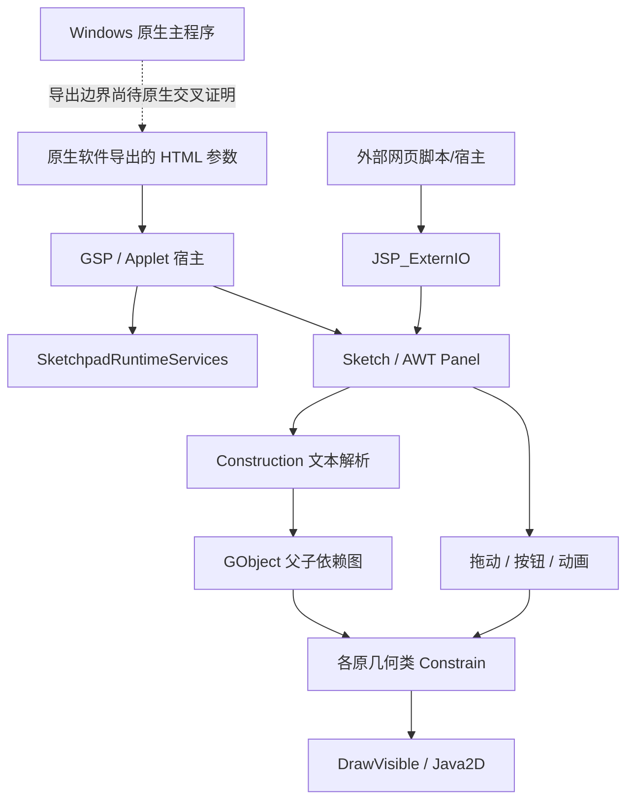

# JavaSketchpad 原发行组件架构与工程恢复边界

日期：2026-10-18。此文先于恢复工程修改形成。分析输入是原发行包 `sketchpad5/Support Files/jsp5.jar`、`analysis/java/decompiled/` 的 CFR 输出、`analysis/java/bytecode/` 的原 class 字节码。原 JAR SHA-256：`270e880a40309aee6c7704ca4aa4786d91032f18f176c50f58458988a88700da`；178,032 字节，143 个 class。逐 class 原始哈希见 `analysis/java/inventory.json`。

## 1. 组件在整个产品中的位置

**已证明：这是原厂发行的网页交互运行库，是可独立恢复的真实原组件；不是 Windows 主程序源码，也不是 GSP 二进制格式读取器。** 根包只有 Applet 入口 `GSP`，其余 142 个 class 都在 `com.keypress.Gobjects`。没有第三方运行库；直接依赖 JDK 的 AWT、Applet、Java2D、集合、观察者、线程及 URL API。

`Build` 保留 `5.0 Build 0970`、grammar version 2，而原生包版本另有依据。不能因同包发行把 Java 运行库覆盖范围等同于 5.06 Windows 桌面版。JAR 中存在原类名、方法名、字段及 `SourceFile`；反编译恢复的局部变量、泛型、控制流拼写不等于原厂源文件。

图中虚线是未完成的原生关联，不是已找出的原生导出函数调用链。

## 2. 原包内职责分区

这些是对同一个原包的分析分区，不应重命名/迁移原类或重新设计模块。

| 分区 | 原类/接口 | 已观察到的职责 |
|---|---|---|
| 宿主入口 | `GSP`, `SketchpadRuntimeServices`, `appletImageFetcher`, `imageFetcher`, `EtchedFrame` | Applet 生命周期、参数/状态/关于页面、相对 codebase 的图片取得 |
| 文档运行与解析 | `Sketch`, `SketchpadRuntimePanel`, `parsingSyntaxError`, `Build`, `Util` | Construction 文本、对象创建、输入分派、样式、绘制、动作生命周期 |
| 外部控制 | `JSP_ExternIO`, `unknownItemListError`, `myObservable` | 测量观察/查询、参数设置、按钮按下、构造文本整体替换 |
| 基础对象与更新 | `GObject`, `AffectedDescendents`, `Draggable`, `Sortable`, `Sort`, `SimpleLock` | 有向依赖、存在/隐藏状态、后代更新、绘制次序、自制锁 |
| 点及约束 | `gPoint`, `MouseFreePoint`, `FreePoint`, `FixedPoint`, `DriverPoint`, `PointOnObject`, `PointOnCircle`, `PointOnStraight`, `PointOnPolygon`, `PointOnSamplerCurve`, `Midpoint`, `LinearIntersection`, `LineCircleIntersection`, `CircleCircleIntersection`, `PlotXY`, `PlotFixedXY` | 点坐标、拖动、路径参数、交点、坐标绘点 |
| 线、圆、区域 | `gStraight`, `gStraightThrough2Points`, `LineThru2Points`, `RayThru2Points`, `SegmentThru2Points`, `Parallel`, `Perpendicular`, `Bisector`, `gCircle`, `CircleCenterPoint`, `CircleCenterAndRadius`, `filledCircle`, `CircleInterior`, `gPolygon`, `PolygonByVertices` | 各几何约束、包含判断、度量、绘制 |
| 坐标系统 | `gCoordSys`, `CoordSysByAxes`, `OriginUnitCoords`, `UnitCircleCoords`, `Axis`, `Axis3`, `Axis4`, `UnitPoint`, `DraggableUnitPoint`, `SimpleUnitPoint`, `SquareUnitPoint`, `RectangularUnitPoint` | 屏幕/数学坐标变换、单位轴与单位点 |
| 测量和函数 | `gText`, `gMeasure`, `SimpleMeasure`, `MultiMeasure`, `CoordinatePair`, `CompoundMeasure`, `Parameter`, `Function`, `parseList`, `exprToken`, `numericConstant`, `variableRef`, `functionEvalRef`, `equFormCompOp`, `predefFunc`, `parseEvalFailure`, `computedRadianAngle`, `computed3PtRatio` | 文本布局、度量、RPN 表达式、参数与函数、自变量及方程成分 |
| 几何变换 | `Transformer`, `Translator`, `Translation`, `VectorTranslation`, `FixedAngleMarkedDistance`, `MarkedAngleMarkedDistance`, `MeasuredAngleFixDistance`, `Reflector`, `Reflection`, `Rotater`, `Rotation`, `MarkedAngleRotation`, `MeasuredAngleRotation`, `Dilater`, `Dilation`, `Dilation2S`, `Dilation3R`, `DilationMR`, `transformedPoint`, `transformedStraight`, `transformedCircle`, `transformedFilledCircle`, `transformedPolygon` | 原对象族虚工厂创建变换像；变换器负责坐标和标量 |
| 动态着色 | `Colorizer`, `ColorizedSpectrum`, `ColorizedGrayscale`, `ColorizedRGB`, `ColorizedHSV` | 复用变换对象机制，根据测量值生成颜色 |
| 采样 | `Sampler`, `SamplerCurve`, `gPointLocus`, `gStraightLocus`, `FunctionPlot`, `Path`, `pathWalk`, `PolygonPathWalk`, `PerimeteredGObj`, `PolygonalPoint`, `QualifiedPoint`, `doublePoint` | 参数路径、点/线轨迹、函数数值采样和临时值对象 |
| 按钮/动画 | `gAction`, `VisibilityButton`, `ShowButton`, `HideButton`, `ToggleVisibilityButton`, `SimultaneousButton`, `PeriodicActionButton`, `animationAction`, `moveAction`, `periodicActionThread`, `ScreenUpdateThread`, `AnimatedPoint`, `PointOnCircleAnim`, `PointOnStraightAnim`, `PointOnPolygonAnim`, `PointOnSamplerCurveAnim` | 可见性、多动作、周期点运动、独立绘制线程 |
| 图片/一般文字 | `gImage`, `gImageOnPoint`, `gImageBetweenPoints`, `BleachImageFilter`, `FixedText`, `PeggedText`, `ConcatText` | 图片定位、淡化、固定/附着/拼接文本 |

完整逐类继承、接口、原文件路径和恢复状态应由 class 清单机械核对，不以本表中的展示分组充当编译模块。

## 3. 继承和依赖约束

`GObject implements Sortable` 是几何对象总基类：`gPoint/gStraight/gCircle/gPolygon/gText/gImage/gAction/gCoordSys/Sampler` 直接或间接继承它。`gMeasure extends gText`，`SimpleMeasure extends gMeasure`，`CompoundMeasure` 和 `Parameter` 再继承 `SimpleMeasure`；**Function 直接继承 gText，不能改成 CompoundMeasure 的子类**。`SamplerCurve extends Sampler implements Path`；`FunctionPlot extends SamplerCurve`。

`Draggable` 是能力接口：`MouseFreePoint`、`PointOnObject`、`DraggableUnitPoint`、`Parameter` 实现它。`GObject.acceptsUserChanges()` 与 `instanceof Draggable` 的配合决定更新列表构建；不是所有点都可自由拖动。

`gStraight/gCircle/gPolygon/SamplerCurve` 提供 `Path`，其中圆和多边形还提供 `PerimeteredGObj`。动作处理根据这些接口选择动画驱动类。`Transformer` 是另一个类体系，**不继承 GObject**；`GObject.createTransformedImage()` 的具体对象族实现返回 `transformed*`，这些像才是依赖图中的对象。

依赖并非单向“UI→内核”：`GObject` 引用 `Sketch`，大量几何基类也含 AWT 绘制和点击处理；`Sketch` 创建几乎所有具体构造类，原包自然形成循环。恢复阶段应整体编译原包，避免为了声称“分层”先切断原依赖、换算法或造 stub。

## 4. 核心数据流及可复查位置

下列行号是未修改的 `analysis/java/decompiled/` 输出；不是原厂源行号。

1. **输入**：`GSP.init()` 创建 `new Sketch(this,new appletImageFetcher(this))`；`GSP.getSketchParameterValue()` 调用 Applet `getParameter()`。`Sketch` 构造器读取 `Construction`；`startup()`（530）→`InitObjects()`（286）→`parseConstruction()`（1028）。解析读取父引用、double、单引号字符串和外观属性，父对象以 1-based 文本序号引用。
2. **对象图**：`GObject.AssignParent()`（325）维护 `Parents[]` 并注册 `Children Vector`；`descendsFrom()`（305）递归检索并缓存祖先查询。`Sketch.InitObjects()`（286）按原构造序为可变对象预计算后代，调用各 `Constrain(false)` 后才 `Sort.shell_sort(GObjs)`。
3. **拖动**：`SketchpadRuntimePanel.mouseDrag()`→`Sketch.JSP_mouseDragged()`→`Draggable.dragTo()`；`MouseFreePoint.dragTo()` 写坐标→`AffectedDescendents.constrainDescendents()`→后代原顺序 `Constrain()`。`existing` 与 `hidden` 分别表示几何可定义性和用户显示开关。
4. **求值**：`CompoundMeasure`/`Function`持有 `parseList`。`parseList.buildTokenList()`（35）读取 RPN；`evaluate()`（184）以 40 项 double 栈执行 token；`variableRef` 读取父测量，`functionEvalRef` 读取父函数，`equFormCompOp` 读取方程成分。`predefFunc.apply()` 处理 13 种预设数值函数。
5. **采样**：`Sampler.Constrain()`（68）移动驱动点、更新依赖、采样被追踪对象后恢复原状态；`constructLocus()`（108）按被追踪对象族选 `gPointLocus/gStraightLocus`。`FunctionPlot.Constrain()`（82）用区间采样函数，再由坐标系统映射到屏幕。
6. **绘制**：`Sketch.paint()`（343）使用 `GObjectsLock`、`UpdaterLock`、offscreen 和 traces 图像缓存，按排序后 `GObjs` 调用 `DrawVisible()`。`GObject` 的绘制次序值（0–6000）不同于 genera（0–9）；不要混为 GSP 记录 kind。
7. **动作**：`PeriodicActionButton.handleClick()` 开始/停止 `periodicActionThread`，后者按 `Sketch.FRAMERATE_MILLISECS` 调 `periodicAction()`；连续更新任务计数控制 `ScreenUpdateThread`。保留原代码中的 `Thread.stop()`；现代化重构不属于源码恢复。
8. **宿主控制**：`JSP_ExternIO`→`Sketch` 的测量/动作查找。`SimpleMeasure.myObserver()` 延迟建立 `myObservable`；数值改变通知观察者。`GSP.setConstruction()` 吞异常且固定返回 0；`Sketch.setConstruction()` 正常返回 2，恢复时必须保留这个边界差异。

原字节码已保存的关键类包括 GSP、Sketch、GObject、AffectedDescendents、MouseFreePoint、parseList、predefFunc、Sampler、FunctionPlot 及交点类，详见 `analysis/java/bytecode/`。修复涉及的 Sort 和 ScreenUpdateThread 新增单独 `javap -c -p -s` 证据于 `recovered/java/provenance/repair-bytecode.txt`。

## 5. Java 与原生的证据边界

| 结论 | 证据强度 |
|---|---|
| Java 库本身有父子依赖图、Constrain 传播、数值表达式和几何变换 | 原 class 的方法/字段和字节码直接证明 |
| 它加载网页 Construction 文本，图片从 codebase 获取 | 原入口与具体调用链证明 |
| 原生最小 GSP 样本有两个点坐标、两父引用的线型对象，结构与 Java 对象图一致 | `java-runtime.md` 第 7 节的样本偏移/值；只是关联候选 |
| 原生对象与 Java 对象共享相同类名、内存布局、虚表、容器、枚举和算法 | **未证明**；不能从 Java 类反向命名所有 native 函数 |
| Java 与原生源代码共享某些原厂 C++/Java 生成器或转换脚本 | **未知**；尚无项目文件或生成规则证据 |
| Java 的全部计算等同桌面版 | **不成立的推断**；已发现 Java trunc 使用 Math.floor，而原生手册描述的负数 trunc 行为不同，需保留差异候选 |
| JAR 可代表桌面版所有迭代、声音、多页、自定义工具和文件保存 | **未证明且当前入口不支持如此声称** |

## 6. 原 CFR 输出的编译探针

原CFR输出包含以下两个javac作用域/控制流错误。可复核证据为`recovered/java/provenance/repair-bytecode.txt`与`recovered/java/provenance/cfr-repairs.patch`，当前构建说明见[Java恢复说明](../recovered/java/RECOVERY.md)。

| 原类/方法 | CFR 问题 | 原字节码支持的最小恢复 |
|---|---|---|
| `Sort.shell_sort(Sortable[])`；原输出 14/17 行 | for 初始化定义 j，但循环外 a[j] 使用它，源码作用域非法 | 字节码 local slot 5 在循环退出后仍用于 aastore（68–73）；把 `int j;` 提到内层 for 前，赋值仍在 for 初始化 |
| `ScreenUpdateThread.run()`；原输出 27 行 | 无限循环及 catch continue 后残留不可达 break | 字节码只有 21→0 和异常处理 25→0 的回跳，无 return/退出分支；删除不可达 break |

不是缺失 143 个类，也没有遇到缺第三方包。Applet、Observable、旧 AWT 事件和 Thread.stop 的告警表示旧 API，不能据此更换实现。`GObject` 的原始 Vector 产生未检查操作告警，也不需要为恢复而改成新容器。

最初探针参数文件使用含中文绝对路径，触发 javac 参数文件平台字符集问题；已改为工作区下纯 ASCII 相对路径并显式设 UTF-8。这是探针调用问题，不是目标源码缺陷。

## 7. 恢复工程的验证边界

原JAR、逐class身份、未修改CFR输出和javap证据用于源码映射；只有上表两处CFR错误有对应补丁。全包编译、成员ABI比较和隔离ClassLoader数值差分分别提供不同层次证据，均不能替代UI/宿主验证。当前构建入口见[Java恢复说明](../recovered/java/RECOVERY.md)，全软件实施顺序见[总计划](../recovered/PLAN.md)。

## 8. 本文不能证明的内容

全量可编译源码仍是“对原 class 的源码恢复”，并非原厂注释、局部变量命名和文件格式排版的还原。即使 ABI 和纯数值差分通过，也不能证明绘制像素、并发、Applet 宿主行为、全部语法错误路径或 native 桌面功能一致。后续验证应逐项增加，不通过修改原算法来迎合测试。

## 9. 已落实的可编译工程与新证据

按上述证据边界组织的源码位于 `recovered/java/`。143 个原类均已编译，141 个恢复源文件与原 CFR 输出逐字节相同，仅 Sort/ScreenUpdateThread 两处有明确补丁；四个非 class 资源也逐字节保留。构建/验证说明见 `recovered/java/RECOVERY.md`。

全量 classfile 检查核对 143 类、461 个字段、648 个原方法/构造器/静态初始化器，原描述符和访问修饰全部保留。**严格 ABI 并不逐项相同**：javac 17 额外生成 14 个 public bridge synthetic 访问桥，另有 SamplerCurve 抽象 getPointOnPath 的旧 Synthetic 属性无法用 Java 源码表达。这 15 个编译器差异在 `build/abi-report.json` 明列；检查不把它们抹掉，不将“原成员保持”写作“二进制完全等价”。

隔离加载原/恢复库的纯数值模型差分通过 2,988 例，0 差异：角度 810、三点比例 810、预设函数 315、RPN 表达式 567（含 199 例相同异常）、几何/父子传播 206、变换 200、排序 80。没有创建 Applet、Sketch 实例、窗口或目标线程，没有调用 paint 或网络。测试覆盖范围不能外推为全部 Java UI 行为，更不能外推到原生程序。

### 原 JAR 中保留的研发历史

新增读取到 JAR 原始资源 `Revision History.txt`、`Ideas_and_Concerns.txt` 和 `testfile.html`，现逐字节保存在 `recovered/java/resources/`，资源哈希见 ABI 报告。这些记录是原发行物内的研发说明，不能把其中“TODO”当作现有实现。

- 1998-04-14 条目说明从 Applet/Bean 宿主中提取 `SketchpadRuntimeServices`，让 Sketch 可嵌入其它运行环境；1999-07-16 条目说明事件处理由 `SketchpadRuntimePanel` 转发到 Sketch。这直接解释现有接口边界，无需重新发明分层。
- 2004-10-25 条目说明转向 XCode 构建、拆成每类一个文件、提取 Build 类；2004-12-10 条目说明 `testfile.html` 是 XCode 调试输入。原构建项目文件本身未发现，因此恢复工程不伪造原 `.xcode`。
- 1996-09-18 的变换构造历史出现 `REFLECT_C`、`DILfR_C`、`ROTfA_C`、`TRANSfXfY_C`、`TRANSfAfD_C`、`TRANSV_C` 等名称；1997-09-09 提及方程成分枚举与桌面导出转换。它们可作为 native 搜索种子，但尚不能证明某个函数地址/记录 kind 或源码共享。
- 2008-09-09 条目明确撤掉暂设的 `Derivative` 导出命令；不能根据函数/RPN 模块宣称已经恢复符号求导器。
